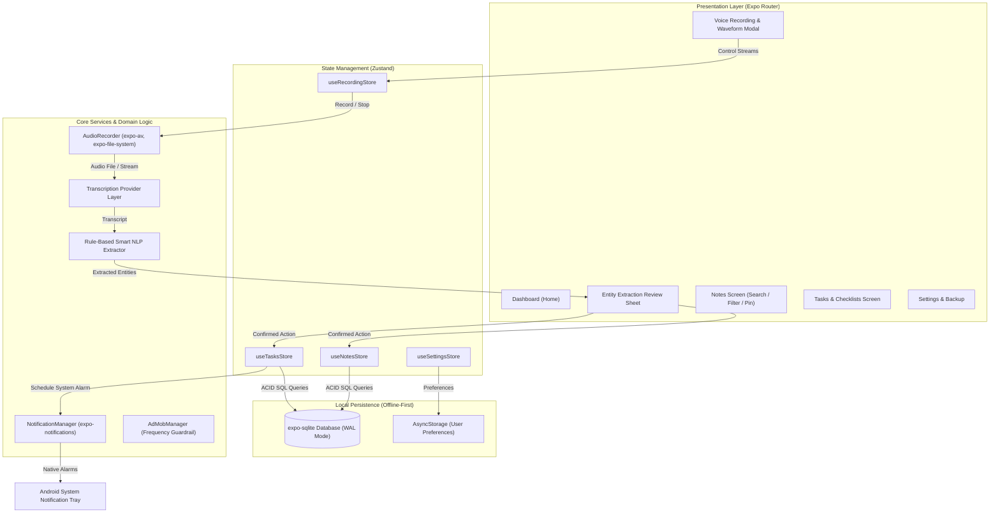

# TalkTask — Complete System Blueprint
**Tagline**: *Speak once. Get things organised.*

TalkTask is a production-grade, offline-first multilingual voice productivity application for Android, engineered with React Native, Expo Router, SQLite, Zustand, and modular speech and NLP extraction engines.

---

## 1. Executive Summary & Product Vision

### 1.1 The Problem
Traditional productivity and note-taking apps require extensive typing, navigation, and manual date-picking. In multilingual, fast-paced environments (particularly in India and emerging markets), users often abandon note-taking because typing long sentences or navigating calendars is too slow and friction-heavy.

### 1.2 The Solution
TalkTask allows users to simply press a button and speak naturally. The system automatically transcribes, classifies intent, extracts temporal data and entities, displays an instant confirmation sheet, persists records to a local SQLite database, and schedules local Android system alarms—all without requiring paid cloud APIs or continuous internet connectivity.

### 1.3 Target Market Strategy
* **Phase 1: India-First**
  * Multilingual recognition tuned for Indian English (`en-IN`), Hindi (`hi-IN`), and Hinglish conversational patterns.
  * Lightweight performance optimized for budget Android hardware.
  * Zero-data / offline-first capability for basic note-taking, checklists, and local reminders.
* **Phase 2: Global-Ready**
  * International English (`en-US`, `en-GB`) with localized date and time formats.
  * Modular speech-to-text interface allowing drop-in addition of global language models.
  * Locale-agnostic settings and currency/time zone normalization.

---

## 2. High-Level System Architecture



---

## 3. Core Module Specifications

### 3.1 Audio Recording Module (`src/services/audio/`)
* **Libraries**: `expo-av`, `expo-file-system`.
* **Audio Specs**: AAC/M4A high-fidelity speech preset (`HIGH_QUALITY`).
* **Live Visual Feedback**: Dynamic audio metering callbacks driving pulse and waveform animations at 60 FPS.
* **Safety Protocols**:
  * Defensively wrapped in `try...catch` blocks.
  * Automatic temporary file cleanup when recordings are discarded.
  * Safe state transitions: `idle` $\rightarrow$ `recording` $\rightarrow$ `paused` $\rightarrow$ `processing` $\rightarrow$ `completed`.

### 3.2 Modular Transcription Provider (`src/services/transcription/`)
The transcription engine utilizes a provider-independent interface:
```typescript
export interface TranscriptionProvider {
  name: string;
  isAvailable(): Promise<boolean>;
  transcribe(audioUri: string, language: LanguageCode): Promise<TranscriptionResult>;
}
```
* **Providers**:
  1. `OnDeviceSpeechProvider`: Leverages native Android speech-to-text when available.
  2. `CloudWhisperProvider`: Configurable endpoint for high-accuracy online transcription.
  3. `MockOfflineSpeechProvider`: Intelligent local fallback ensuring zero crash risk during offline use or testing.

### 3.3 Rule-Based NLP & Extraction Engine (`src/services/nlp/`)
* **Intent Categorization**: Automatically classifies transcripts into:
  * `task`: Action items, chores, errands.
  * `reminder`: Time-bound commitments needing notifications.
  * `checklist`: Lists of items (groceries, supplies, multi-step tasks).
  * `note`: Thoughts, journal entries, ideas, minutes of meeting.
* **Multilingual Temporal Normalizer**:
  * **English Expressions**: "today", "tomorrow", "day after tomorrow", "next Monday", "at 5 PM", "morning 9 AM".
  * **Hindi / Hinglish Expressions**: "aaj", "kal", "parson", "somwar", "sham 5 baje", "dopahar 2 baje", "subah 8 baje".
* **Checklist Itemizer**:
  * Detects lists and breaks down commas, bullets, and conjunctions ("and", "aur", "tatha").
  * Example: *"Buy milk, eggs, bread aur sabzi"* $\rightarrow$ 4 independent checklist items.
* **Ambiguity Handling**:
  * If a user states an ambiguous time ("next Friday"), the system marks confidence as low and mandates user confirmation in the review sheet before scheduling.

### 3.4 Local SQLite Database & Schema (`src/services/db/`)
* **Database Engine**: `expo-sqlite` with Write-Ahead Logging (WAL) and foreign keys enabled.
* **Migration Framework**: `schema_migrations` table ensures versioned, repeatable DDL upgrades.

```sql
PRAGMA foreign_keys = ON;

-- 1. Notes Table
CREATE TABLE IF NOT EXISTS notes (
    id TEXT PRIMARY KEY,
    title TEXT NOT NULL,
    content TEXT NOT NULL,
    source_type TEXT DEFAULT 'voice', -- 'voice' | 'manual'
    language TEXT DEFAULT 'en',
    category TEXT DEFAULT 'general',  -- 'personal' | 'work' | 'ideas'
    is_pinned INTEGER DEFAULT 0,
    is_favourite INTEGER DEFAULT 0,
    created_at TEXT NOT NULL,
    updated_at TEXT NOT NULL
);
CREATE INDEX IF NOT EXISTS idx_notes_created ON notes(created_at DESC);
CREATE INDEX IF NOT EXISTS idx_notes_pinned ON notes(is_pinned DESC, updated_at DESC);

-- 2. Tasks Table
CREATE TABLE IF NOT EXISTS tasks (
    id TEXT PRIMARY KEY,
    title TEXT NOT NULL,
    description TEXT,
    status TEXT DEFAULT 'pending',     -- 'pending' | 'completed'
    priority TEXT DEFAULT 'medium',   -- 'low' | 'medium' | 'high' | 'urgent'
    due_at TEXT,
    created_at TEXT NOT NULL,
    updated_at TEXT NOT NULL
);
CREATE INDEX IF NOT EXISTS idx_tasks_status ON tasks(status);
CREATE INDEX IF NOT EXISTS idx_tasks_due ON tasks(due_at);

-- 3. Checklists & Items
CREATE TABLE IF NOT EXISTS checklists (
    id TEXT PRIMARY KEY,
    title TEXT NOT NULL,
    created_at TEXT NOT NULL,
    updated_at TEXT NOT NULL
);

CREATE TABLE IF NOT EXISTS checklist_items (
    id TEXT PRIMARY KEY,
    checklist_id TEXT NOT NULL,
    text TEXT NOT NULL,
    is_completed INTEGER DEFAULT 0,
    sort_order INTEGER DEFAULT 0,
    FOREIGN KEY(checklist_id) REFERENCES checklists(id) ON DELETE CASCADE
);
CREATE INDEX IF NOT EXISTS idx_checklist_items ON checklist_items(checklist_id, sort_order ASC);

-- 4. Reminders Table
CREATE TABLE IF NOT EXISTS reminders (
    id TEXT PRIMARY KEY,
    linked_type TEXT,                 -- 'task' | 'note' | 'standalone'
    linked_id TEXT,
    title TEXT NOT NULL,
    scheduled_at TEXT NOT NULL,
    notification_id TEXT,
    status TEXT DEFAULT 'scheduled',   -- 'scheduled' | 'fired' | 'cancelled'
    created_at TEXT NOT NULL
);
CREATE INDEX IF NOT EXISTS idx_reminders_sched ON reminders(scheduled_at, status);

-- 5. Transcriptions Audit Log
CREATE TABLE IF NOT EXISTS transcriptions (
    id TEXT PRIMARY KEY,
    source_type TEXT DEFAULT 'voice_recording',
    transcript TEXT NOT NULL,
    language TEXT NOT NULL,
    provider TEXT NOT NULL,
    created_at TEXT NOT NULL
);
```

### 3.5 Notification & System Alarm Scheduler (`src/services/notifications/`)
* **Native Integration**: `expo-notifications`.
* **Channel Configuration**:
  * Channel Name: `TalkTask Reminders`
  * Importance: `Notifications.AndroidImportance.MAX`
  * Vibration & Sound enabled.
* **Boot Resyncing**:
  * When the Android device reboots or the app launches, `resyncUpcomingReminders()` fetches all active future reminders from SQLite and re-registers alarms with the OS.
* **Defensive Design**:
  * Android 13+ runtime permissions (`POST_NOTIFICATIONS`) requested gracefully.
  * Removal of deprecated `AndroidNotificationPriority` properties ensures full compatibility with modern Expo SDK versions.

### 3.6 Non-Intrusive Monetization Guardrails (`src/services/ads/`)
* **Core Principles**:
  1. **Never Disrupt Workflow**: Ads never appear while recording speech or during initial item creation.
  2. **Frequency Capping**: Interstitial displays are throttled to a minimum of 4 successfully completed user workflows.
  3. **Pro User Flag**: `isProUser` in `useSettingsStore` instantly bypasses all advertisement hooks.

---

## 4. End-to-End User Interaction Flow

```
[User Taps Main Mic Button]
            │
            ▼
[Audio Stream Activated]
 ├── Real-time wave animation based on metering
 └── Live duration timer running
            │ (User stops speaking)
            ▼
[Transcription Pipeline]
 └── Audio sent to selected provider -> Raw text output
            │
            ▼
[NLP Entity Extraction]
 ├── Determines intent: task / reminder / checklist / note
 ├── Parses dates/times ("kal sham 5 baje" -> tomorrow 17:00)
 └── Splits bullet points or list items
            │
            ▼
[Pre-Save Confirmation Sheet]
 ├── User reviews parsed title, category, date, and checklist items
 └── Allows instant one-tap corrections
            │
            ▼
[Data Persistence & Scheduling]
 ├── SQLite transaction writes record(s)
 ├── NotificationManager schedules local alarm
 └── Dashboard and tab stores reload reactively
```

---

## 5. Security, Privacy & Offline-First Guarantees

* **Zero Cloud Dependency for Core Use**: Notes, tasks, checklists, and local reminders function 100% offline.
* **Local Data Sovereignty**: All user data resides in SQLite on the user's physical device storage.
* **No Hardcoded Secrets**: Optional cloud endpoints use secure environment variables; core functionality operates without API keys.
* **Export & Backup**: Full JSON export and backup support allows users to extract or restore their complete database at any time.

---

## 6. Production Build & Release Specifications

* **Framework**: React Native `0.88.1`, Expo SDK `58.0.23`, Expo Router `58.0.30`.
* **Compilation**: Hermes JavaScript Engine with bytecode precompilation.
* **ProGuard / R8 Configuration**:
  * Custom Expo Config Plugin (`plugins/withProguard.js`) injects `-dontwarn **` and keeps native reflection classes for `expo-av`, `expo-file-system`, and `expo-modules-core`.
  * `android.enableMinifyInReleaseBuilds=false` ensures clean release APK packaging without stripping required native bindings.
* **Distribution Profiles (`eas.json`)**:
  * `preview`: Generates standalone installable APK (`buildType: "apk"`).
  * `production`: Generates signed Android App Bundle (AAB) ready for Google Play Store upload.
